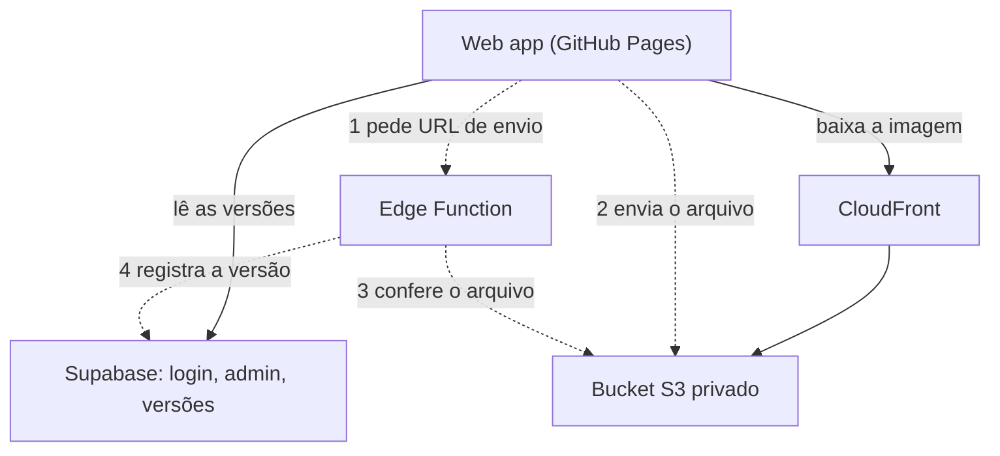

# Imagens do site fora do Supabase (S3 + CloudFront)

**Situação (2026-11-04): AWS criada, aguardando a virada.** O bucket, o CloudFront, o
usuário restrito, os secrets e a função já estão no ar, e os arquivos foram copiados.
O site publicado ainda lê do Supabase. Falta publicar a web, aplicar a migração e
testar pelo lápis (`infra/site-images/README.md`, passo 4). O código está nas branches
`imagens-s3` (backend) e `admin/imagens-s3` (web).

**Motivo:** o volume cresce com o Monstrous Manual. Só por custo a migração ainda não
se paga: as imagens do Forge ocupam cerca de 9 MB hoje. Com uns 500 monstros e algumas
versões de cada, o total chegaria perto de 0,6 GB, o que já pode apertar o plano Free.

## Decisão

S3 + CloudFront para os arquivos. No Supabase ficam o login, o perfil Admin e a
tabela `site_image_version`: só os arquivos mudam de lugar. O site não tem servidor
próprio (GitHub Pages), então entra uma Edge Function para guardar as credenciais
da AWS, que não podem ir para o navegador. Seria a primeira Edge Function do backend.

## Como funciona

**Leitura.** O app continua lendo `site_image_version` no Supabase. Só o endereço
das imagens muda em `siteImageURL`, de Supabase Storage para CloudFront.

**Envio pelo lápis:**

1. A função confere `is_admin()` com o login do usuário e devolve uma URL de envio
   válida por 5 minutos, presa ao caminho, ao tipo WebP e ao tamanho do arquivo.
2. O navegador envia o arquivo direto ao S3.
3. A função confere que o arquivo chegou, com o tipo certo e até 5 MB.
4. A função chama `add_site_image_version` com o login do admin, então
   `uploaded_by` continua certo e a chave `service_role` fica de fora.

Um arquivo enviado e recusado no passo 3 fica órfão no bucket, porque a credencial
não apaga. Não faz mal: o caminho é um UUID e nenhuma versão aponta para ele.

## Por que S3 + CloudFront

| | S3 + CloudFront | Cloudflare R2 | Supabase (hoje) |
|---|---|---|---|
| "Todas as versões, para sempre" | Forte: a credencial pode só gravar, sem apagar, e o bucket tem versionamento | Exige configurar bloqueio de retenção | Política no banco, sem permissão de apagar |
| Domínio próprio | Não precisa (`*.cloudfront.net`) | Precisa de domínio na Cloudflare ou de um Worker | Não precisa |
| Tráfego | 1 TB/mês grátis | Grátis, sem limite de saída | 5 GB/mês no plano Free |
| Armazenamento | Centavos de dólar por mês neste volume | 10 GB grátis | 500 MB ou 1 GB no plano Free; as fontes divergem |

Havendo um domínio na Cloudflare, o R2 também serve e custa menos em tráfego. O
desenho é o mesmo, porque ele usa a mesma API do S3.

Preços levantados em 2026-11-04, principalmente em sites de terceiros: confira as
páginas oficiais antes de decidir. Contas AWS novas no plano gratuito de 6 meses
não podem usar os planos fixos do CloudFront, mas a cota de 1 TB do modelo normal
continua valendo. O preço do armazenamento no S3 não foi conferido nessa pesquisa.

## O que muda

- **Backend:** nova Edge Function e migração que tira de `add_site_image_version` a
  checagem em `storage.objects`, passando essa conferência para a função. Mudam
  também `supabase/tests/16_admin_e_imagens_do_site.test.sql` e
  `docs/modelo-de-dados-e-sync.md`.
- **Web:** `src/lib/siteImages.ts`, `src/config.ts` e `scripts/seed-site-images.mjs`.
  O painel do lápis não muda.
- **AWS:** bucket privado com versionamento, CORS para
  `https://tatarana.github.io` e `http://localhost:5174`, CloudFront com cache longo
  e uma credencial sem permissão de apagar. As credenciais ficam nos secrets da
  Edge Function, nunca no repo.

A API continua atendendo o app iPad por HTTP puro: a leitura é a mesma tabela mais
uma URL pública. O envio de imagens só existe na web.

## Migração

`storage_path` é relativo. Basta copiar os arquivos para o S3 com os mesmos caminhos
e trocar o endereço base, sem alterar nenhuma linha da tabela. Para voltar atrás, é
só restaurar o endereço. O bucket `site-images` fica intacto como backup; apagá-lo é
uma decisão à parte, depois de a migração se provar.

## Limite que continua

Se o Supabase cair ou pausar, a lista de versões some e o app volta aos arquivos do
repo, como hoje. Tirar os arquivos do Supabase não resolve isso.

## Fontes

- [Preços do Cloudflare R2](https://developers.cloudflare.com/r2/pricing)
- [Custos do R2 em 2026 (Upstash)](https://upstash.com/kb/cloudflare-r2-pricing-in-2026-storage-operations-and-real-monthly-bills)
- [Planos fixos do CloudFront (AWS)](https://docs.aws.amazon.com/ja_kr/AmazonCloudFront/latest/DeveloperGuide/flat-rate-pricing-plan.html)
- [Preços do CloudFront em 2026 (Cloudburn)](https://cloudburn.io/blog/amazon-cloudfront-pricing)
- [Plano gratuito do CloudFront (Costbench)](https://costbench.com/software/cdn/amazon-cloudfront/free-plan/)
- [Preços do Supabase (Toolradar)](https://toolradar.com/tools/supabase/pricing)
- [Preços do Supabase em 2026 (MakerKit)](https://makerkit.dev/blog/saas/supabase-pricing)
- [Autenticação em Edge Functions (Supabase)](https://supabase.com/docs/guides/functions/auth-headers.md)
